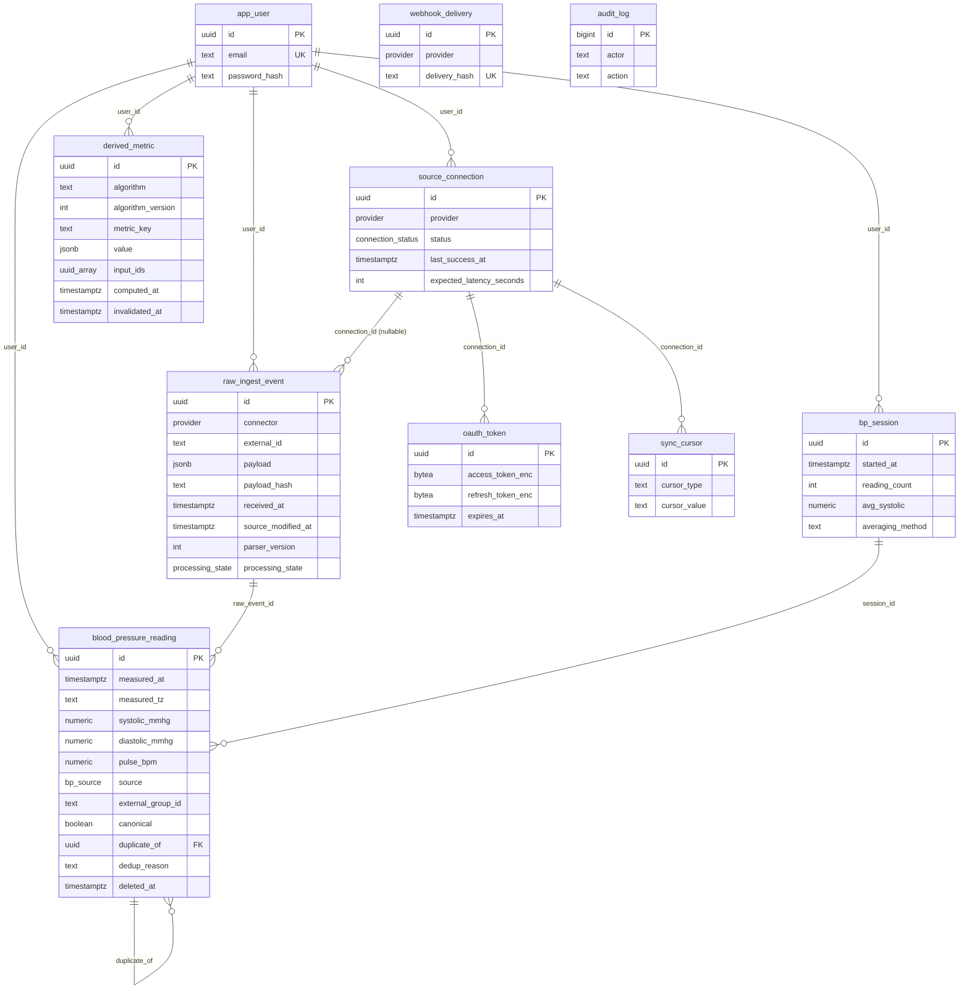

# Ben Health OS — Data Model

Status: Phase 1 (blood pressure + platform foundation).
Normative sources: `docs/contracts/phase1-contracts.md` (binding for Phase 1
code) and `docs/brief/build-brief-v2.md` §3, §5, §12, §13. The **migration
files in `packages/db/migrations/` are the source of truth for the concrete
schema**; SQL fragments in this document are summaries, not definitions.

---

## 1. The three-layer architecture

All health data flows through three strictly separated layers. The separation
exists so that we can always answer "where did this number come from, and how
was it computed?" — and so that reprocessing, dedup corrections, and algorithm
changes never destroy history.

### Layer 1 — Immutable raw ingestion

Every payload that enters the system — a Withings `getmeas` measure group, a
HealthKit BP correlation batch item, a manual entry, a webhook notification —
is persisted verbatim as a `raw_ingest_event` **before** any interpretation
happens. Rows carry the connector, the source's external identifier (Withings
`grpid`, HealthKit UUID), source device id, event type, the full JSON payload,
a SHA-256 hash of the canonical JSON, receipt time, the source's own
modification timestamp when known, and the `parser_version` in effect at
ingest time.

Raw rows are **immutable except processing metadata**
(`processing_state`, `processed_at`, `error`) — enforced mechanically by
column-limited UPDATE grants in `0005_grants.sql`, not by convention. There is
no DELETE grant. If a payload was parsed wrongly, we fix the parser, bump
`parser_version`, and re-normalize from the retained raw rows; we never edit
them.

`processing_state` is one of `pending | processed | failed |
skipped_duplicate` (`0002_enums.sql`). `skipped_duplicate` records that a raw
duplicate arrived and was deliberately not normalized — the evidence is kept,
nothing is silently dropped.

### Layer 2 — Source-neutral normalized observations

Normalization turns raw payloads into typed, unit-normalized, queryable
observations. In Phase 1 the concrete observation types are
`blood_pressure_reading` and its grouping entity `bp_session`. A normalized
row always links back to its `raw_ingest_event` (`raw_event_id`), so every
value in the app is traceable to the exact bytes that produced it.

Layer 2 is where dedup, session grouping, quality flags, soft deletes, and
corrections live. Normalized rows may be updated (canonicality transfer,
session reassignment) or soft-deleted, but the raw evidence beneath them never
changes.

### Layer 3 — Versioned derived analytics

Anything computed *from* observations — rolling averages, trends,
morning/evening splits, baselines — is a `derived_metric` row stamped with the
`algorithm` name, an integer `algorithm_version`, the input observation ids
(`input_ids`), coverage/completeness, confidence, and `computed_at`.

**Derived metrics are never silently overwritten.** When an algorithm
changes, it gets a new version; new rows are written under the new version and
superseded rows are marked with `invalidated_at`. Old results remain
inspectable, so a chart rendered last month can still be explained this month.

### Rule of flow

Data moves only forward: Layer 1 → Layer 2 → Layer 3. The API and both
clients read Layer 2/3 (plus connection/freshness state); nothing serves raw
payloads to the UI by default, and nothing writes "down" a layer.

---

## 2. Full entity catalog (target architecture, brief §12)

The long-term normalized model comprises the entities below. **Bold** entities
exist in Phase 1 (sometimes under a concrete table name); the rest are planned
in later phases and listed so that Phase 1 naming and shape stay compatible
with them.

| Area | Entities | Phase 1 realization |
|---|---|---|
| Identity & sync | **User**, **SourceConnection**, SourceDevice, **SyncCursor** | `app_user`, `source_connection`, `sync_cursor` (device captured as text columns for now) |
| Raw layer | **RawIngestEvent** | `raw_ingest_event` |
| Observations | Observation (generic), **BloodPressureReading**, **BloodPressureSession**, GlucoseSample, SleepSession, SleepStage, Workout, DailyActivity, BodyMeasurement | `blood_pressure_reading`, `bp_session` |
| Nutrition | NutritionDay, Meal, NutrientObservation | Phase 4 |
| Clinical | LabResult, LabPanel, Medication, MedicationSourceRecord, MedicationReconciliation, Condition, ClinicalEvent, Document | Phases 4–5 |
| Subjective | Symptom, JournalEntry, HealthGoal | later phases |
| Experiments | HealthExperiment, ExperimentPhase | Phase 7 |
| Recommendations | Recommendation, RecommendationEvidence, Alert | Phase 6 |
| Derived | **DerivedMetric**, AlgorithmVersion | `derived_metric` (version as a column; a first-class AlgorithmVersion table comes with the baseline engine) |
| Reports | WeeklyHealthReport, MonthlyHealthReport, PhysicianBrief | Phases 5–6 |

Design consequence for Phase 1: even though only BP exists, the columns that
future entities will need everywhere (`user_id`, provenance, timestamps,
canonical/duplicate linkage, soft delete) are already standardized, so new
observation types are additive migrations, not reshapes.

---

## 3. Phase 1 concrete schema (contracts §2)

Defined across `packages/db/migrations/0001_extensions.sql` (pgcrypto),
`0002_enums.sql`, `0003_tables.sql`, `0004_rls.sql`, `0005_grants.sql`.
PostgreSQL 16; all timestamps `timestamptz` (UTC storage, rule 9).

**Enums** (exact strings): `provider` (`withings`, `apple_health`, `oura`,
`stelo`, `cronometer`, `function`, `clinical_records`, `manual`,
`benhealth`); `connection_status` (`connected`, `error`, `revoked`,
`not_connected`); `freshness_status` (`CURRENT`, `RECENT`,
`DELAYED_BY_SOURCE`, `STALE`, `SYNC_ERROR`, `NOT_CONNECTED`,
`INSUFFICIENT_DATA`); `processing_state` (above); `bp_source`
(`withings_api`, `apple_health`, `manual`); `arm` (`left`, `right`,
`unknown`); `body_position` (`seated`, `standing`, `lying`, `unknown`).

**Tables** (see `0003_tables.sql` for authoritative DDL):

- `app_user` — identity; email + argon2id `password_hash` in local auth mode.
- `source_connection` — one row per (user, provider); status, error state,
  `last_success_at`, `expected_latency_seconds` (freshness input), metadata.
- `oauth_token` — AES-256-GCM-encrypted access/refresh tokens
  (`iv || tag || ciphertext`); never serialized by the API layer.
- `sync_cursor` — durable per-connection cursors (e.g.
  `withings_lastupdate`), the mechanism that heals missed webhooks.
- `raw_ingest_event` — Layer 1. Dedup guard: a unique expression index on
  `(connector, coalesce(external_id, ''), payload_hash)` so identical
  payloads without a stable external id are still caught (a plain UNIQUE
  would treat NULL ids as distinct); `''` is a reserved sentinel protected by
  a CHECK constraint. Partial index on `pending` rows for the worker queue.
- `bp_session` — grouping of consecutive canonical readings (gap ≤ 15 min),
  with stored averages, `averaging_method`
  (`mean_all` | `mean_excluding_first`; the latter when ≥ 3 readings), and
  `first_reading_excluded`. Recomputed idempotently after each ingest batch.
- `blood_pressure_reading` — Layer 2. Values with plausibility CHECKs
  (systolic 40–300, diastolic 20–200, pulse 20–250), `measured_at` +
  `measured_tz`, source triple (`source`, `source_app`, `source_device`),
  `external_group_id`, measurement context (arm, body position, seated rest,
  reading number, note), dedup fields (`canonical`, `duplicate_of`,
  `dedup_reason`), `quality_flags[]`, and `deleted_at` (soft delete only —
  no hard-DELETE grant).
- `derived_metric` — Layer 3 as described in §1.
- `audit_log` — pre-redacted action trail; deliberately no FK on `user_id`
  so audit rows survive explicit user deletion.
- `webhook_delivery` — idempotency journal, unique on
  `(provider, delivery_hash)`.

**RLS** (`0004_rls.sql`): every user-data table has row-level security
checking `user_id = current_setting('app.user_id', true)::uuid`; the service
role `benhealth_app` is not `BYPASSRLS`; `webhook_delivery` and
`schema_migrations` are service-internal. Migrations are append-only and
numbered; edit-after-merge is forbidden.

### Phase 1 ER diagram

(`webhook_delivery` and `audit_log` are intentionally unlinked: the webhook
journal is service-internal, and audit rows outlive users.)

---

## 4. Provenance and timestamp semantics

Every measurement carries multiple timestamps with distinct meanings; conflating
them is a correctness bug (brief §3, CLAUDE.md rule 9).

| Timestamp | Meaning | Phase 1 column |
|---|---|---|
| `measured_at` | When the physiological measurement actually happened. **The only timestamp charts and analytics use for placement on the time axis.** | `blood_pressure_reading.measured_at` (+ `measured_tz`, IANA zone, for local semantics like morning/evening splits) |
| `source_synced_at` | When the source system last saw/modified the record (e.g. Withings group modification time). Used for corrected-measurement detection and cursor advancement. | `raw_ingest_event.source_modified_at` |
| `ingested_at` | When our platform received the payload. | `raw_ingest_event.received_at` |
| `normalized_at` | When normalization produced the observation row. | `blood_pressure_reading.created_at` (a dedicated column arrives when the generic Observation entity does) |
| last connector success | When the connector last completed successfully — distinguishes "connector broken" from "source quiet". | `source_connection.last_success_at` |

Freshness (`packages/shared`, mirrored in Swift) is computed from
`connectionStatus`, `lastSuccessAt`, `latestMeasuredAt`,
`expectedLatencySeconds`, and `now` per contracts §3 — notably
`DELAYED_BY_SOURCE` requires a *healthy* connector (`now − lastSuccessAt ≤
6 h`) with quiet data (age ≤ 72 h), which is only expressible because sync
success and measurement time are stored separately. "LIVE" is forbidden in
all UI copy.

Storage is UTC (`timestamptz`) everywhere; `measured_tz` preserves capture
timezone where semantics need it (morning BP = 04:00–11:59 local).

---

## 5. Deduplication: evidence hierarchy and canonical-source policy

Dedup (brief §5/§13, contracts §4) runs at normalization time, is a
first-class subsystem, and **never deletes anything** — both raw records are
retained; one normalized record is canonical, the other is linked to it.

Evidence hierarchy, strongest first:

1. **Same connector + same `external_id`** — raw-level duplicate. The new
   raw row is still recorded (unique index permitting) but normalization is
   skipped: `processing_state = 'skipped_duplicate'`.
2. **Same connector + same `external_group_id`** (Withings grpid, HealthKit
   correlation UUID) — same measurement group.
3. **Same `payload_hash`** — byte-identical content.
4. **Same metric + exact `measured_at` + equal values + same source device.**
5. **Cross-source tolerance match**: |Δ measured_at| ≤ 180 s AND systolic
   equal AND diastolic equal (as integers after rounding) AND (pulse both
   null or |Δ pulse| ≤ 5). This is what catches a Withings reading arriving
   both via the API and via Apple Health.
6. **User-confirmed** (Phase 2 UI).

**Canonical-source policy** (BP): `withings_api` > `apple_health` >
`manual` — the source closest to the measuring device wins. The losing
reading gets `canonical = false`, `duplicate_of = <winner id>`, and
`dedup_reason = <rule that fired>`. Provenance is never erased: the duplicate
row, its source attribution, and its raw event all remain queryable.

**Canonicality transfer**: order of arrival does not decide the winner. If
Apple Health delivers first and the Withings API record arrives later, the
new Withings row becomes canonical and the earlier Apple Health row is
demoted in the same operation. Analytics and API responses include only rows
with `canonical AND deleted_at IS NULL` unless `includeDuplicates=true` is
requested.

Related invariants: missing values are never coerced to zero (an absent pulse
stays `NULL` end to end), and readings are never averaged before overlap
determination.

---

## 6. Soft delete and corrections

- **Soft delete only.** `blood_pressure_reading.deleted_at` is the sole
  deletion mechanism at Layer 2; the app role has no DELETE grant on the
  table (`0005_grants.sql`). A soft-deleted reading disappears from
  analytics/API defaults but its row and raw evidence persist. Deletions
  observed upstream (e.g. a reading removed from Apple Health) are handled
  the same way — mark, never purge.
- **Corrections from the source** (e.g. an edited Withings measurement): the
  corrected payload arrives as a *new* `raw_ingest_event` — same
  `external_id`, different `payload_hash`, so it passes the raw dedup index
  — normalizes to a new reading, and supersedes the prior one via the
  canonical/duplicate linkage; `source_modified_at` records when the source
  changed it. The demo persona fixtures include exactly this scenario.
- **Cascade effects**: sessions containing affected readings are recomputed
  idempotently, and derived metrics whose `input_ids` include the changed
  reading are marked `invalidated_at` and recomputed — never edited in
  place.

---

## 7. Algorithm versioning for derived metrics

Rules (CLAUDE.md rule 2, brief §12):

1. Every derived value records `algorithm`, integer `algorithm_version`,
   `metric_key`, period, `input_ids`, `coverage`, `confidence`,
   `computed_at`.
2. Changing computation logic in a way that can change results **requires a
   version bump**; new results are written as new rows under the new version.
3. Superseded or input-invalidated rows get `invalidated_at`; they are never
   updated or deleted. Readers take the latest non-invalidated row for a
   `metric_key`/period.
4. Because `input_ids` is stored, any historical number can be re-derived and
   explained: which readings, which algorithm, which version, computed when.

A dedicated `AlgorithmVersion` registry table (per brief §12) is planned
alongside the Phase 2 baseline engine; in Phase 1 the (algorithm, version)
pair on each row is sufficient.
